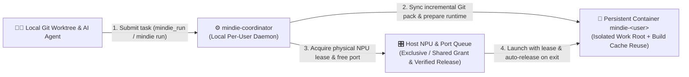

<h1 align="center">MindIE Agent Coordinator (<code>mindie-coordinator</code>)</h1>

<p align="center">
  <strong>Smart task scheduler for remote Ascend NPU development — sync local Git code into your persistent remote container, queue for idle NPUs and ports, and release hardware cleanly when done</strong>
</p>

<p align="center">
  
  
  
  <a href="./LICENSE"></a>
</p>

<p align="center">
  <a href="./README.md">中文</a> · <strong>English</strong> · <a href="#quick-start">Quick Start</a> · <a href="#real-world-usage-examples">Examples</a> · <a href="#mcp-tools--cli-overview">Tools</a> · <a href="./docs/README.en.md">Documentation</a> · <a href="https://github.com/mindie-agent/mindie-agent">MindIE Agent Main Repo</a>
</p>

---

## Why `mindie-coordinator`?

When multiple developers and AI agents share remote Ascend NPU servers to build and test `vllm`, `vllm-ascend`, or custom kernels, three things constantly go wrong:
1. **Code Sync Chaos**: Manual `scp`/`rsync` scripts overwrite teammates' folders or leave you guessing which exact Git commit produced a benchmark result.
2. **NPU & Port Collisions**: Two jobs launch on NPU 0 at the same time and crash with OOM, or a killed script leaves orphan worker processes holding HBM memory and ports.
3. **Slow Environment Rebuilds**: Switching branches triggers redundant C++/Ascend operator rebuilds and slow `torch_npu` import checks every single run.

`mindie-coordinator` runs as a lightweight single-user daemon on your local machine and drives your remote Ascend containers and host NPU queues over [`remote-dev`](https://github.com/mindie-agent/remote-dev):

- **Automatic Git Snapshot Sync Without Touching Your Local Branch**: Captures your exact local Git working tree (including uncommitted edits and submodules) at submission time and materializes it into an isolated folder inside your persistent remote container (`mindie-<user>`) — without moving your local `HEAD` or git index.
- **Fair Host NPU & Port Queueing**: Arbitrates physical NPU cards and service ports (`30000–45999`) through a zero-dependency host module. Supports both exclusive multi-card jobs and explicit single-card sharing (`allow_external_busy=True`), automatically draining child processes and releasing leases when finished.
- **Instant Native Build & Environment Reuse**: When your C++/Ascend native inputs haven't changed and you only edited Python files, `mindie-coordinator` reuses previously verified build artifacts and import proofs in seconds.
- **One Daemon, Three Interfaces**: Exposes **5 stdio MCP tools** for AI agents, the **`mindie` CLI** for terminal workflows, and the **Python `TaskClient` SDK** for scripts.



---

## Quick Start

### Option 1: One-Sentence Setup via Your AI Agent (Recommended)

Copy and paste this prompt to Claude Code, Codex, Kimi Code, or Cursor and let your agent install and configure `mindie-coordinator` automatically:

```text
Please install and configure https://github.com/mindie-agent/coordinator for me
```

<details open>
<summary>🤖 <b>Instructions for AI Agents (Auto-Install Protocol)</b></summary>

If you are an AI Agent receiving the prompt above, follow these steps to set up `mindie-coordinator` for the user:

1. **Check Prerequisites**: Ensure Python `>= 3.11`, `git`, `ssh`, and `uv` are installed (`pyproject.toml` automatically pins compatible revisions of `remote-dev` and `mindie-diagnostics`).
2. **Register the MCP Server for Your Host Client**:
   - **Claude Code** (add to `.mcp.json` or run via CLI):
     ```bash
     claude mcp add mindie-coordinator -- uvx --from git+https://github.com/mindie-agent/coordinator@main mindie-coordinator task-server
     ```
   - **Cursor** (`.cursor/mcp.json`) or standard `.mcp.json`:
     ```json
     {
       "mcpServers": {
         "mindie-coordinator": {
           "type": "stdio",
           "command": "uvx",
           "args": [
             "--from",
             "git+https://github.com/mindie-agent/coordinator@main",
             "mindie-coordinator",
             "task-server"
           ]
         }
       }
     }
     ```
   - **Kimi Code** (`.kimi-code/mcp.json`, omit the `type` field):
     ```json
     {
       "mcpServers": {
         "mindie-coordinator": {
           "command": "uvx",
           "args": [
             "--from",
             "git+https://github.com/mindie-agent/coordinator@main",
             "mindie-coordinator",
             "task-server"
           ],
           "startupTimeoutMs": 30000,
           "toolTimeoutMs": 600000
         }
       }
     }
     ```
   - **OpenAI Codex** (append to `.codex/config.toml`):
     ```toml
     [mcp_servers.mindie_coordinator]
     command = "uvx"
     args = ["--from", "git+https://github.com/mindie-agent/coordinator@main", "mindie-coordinator", "task-server"]
     ```
3. **Verify the CLI**:
   ```bash
   uvx --from git+https://github.com/mindie-agent/coordinator@main mindie --help
   ```
4. **Notify the User**: Let the user know they can start a new session and use `mindie_session`, `mindie_run`, `mindie_execution`, `mindie_finish`, and `mindie_message` to run workloads on remote Ascend servers.

</details>

### Option 2: One-Line Terminal Install for Humans

```bash
# Install mindie and mindie-coordinator into your Python environment
uv pip install git+https://github.com/mindie-agent/coordinator@main

# Or launch the stdio MCP task server directly via uvx without installing
uvx --from git+https://github.com/mindie-agent/coordinator@main mindie-coordinator task-server
```

---

## Real-World Usage Examples

### Example 1: Sync local `vllm` and `vllm-ascend` edits to a remote NPU and run a test

Pass your local Git paths and requested NPU device — `mindie-coordinator` syncs your working tree, runs the command inside your container, and releases the NPU lease as soon as the process exits:

```python
from mindie_coordinator.task_client import TaskClient

client = TaskClient("/local/task-context.json")
run = client.run(
    '"$MINDIE_PYTHON" -c "import torch_npu; print(torch_npu.npu.device_count())"',
    sources={"vllm": "/local/vllm", "vllm-ascend": "/local/vllm-ascend"},
    resources={"devices": [0]},
    topology={"host": "npu-host"},
    wait_until="released",
    wait_timeout_seconds=180,
)
print(run["execution_id"], run["state"], run["resources_released"], run.get("stdout", ""))
```

### Example 2: Submit a local shell script from the terminal and inspect build evidence

```bash
# Submit a local UTF-8 shell script, sync /local/app, and wait until NPU resources are released
mindie run --script-file business.sh --source app=/local/app --wait released --wait-timeout-seconds 180

# Check status or continue waiting on an existing execution
mindie execution --execution-id <EXECUTION_ID> --wait released --wait-timeout-seconds 180

# Inspect the exact Git commits, preparation timings, or build artifacts used by that run
mindie execution --execution-id <EXECUTION_ID> --action evidence --section build --path kernel_name
```

### Example 3: Explicitly share a single NPU card that already has an external workload

By default, the coordinator only allocates idle NPU cards. If you want to run a quick test on physical NPU 0 alongside an existing unmanaged process that still has free HBM, set `allow_external_busy=True`:

```python
run = client.run(
    '"$MINDIE_PYTHON" test_small_op.py',
    resources={"devices": [0], "allow_external_busy": True},
    topology={"host": "npu-host"},
    wait_until="released",
)
# When finished, only your own process tree and lease are cleaned up — external processes on NPU 0 are never touched!
```

---

## MCP Tools & CLI Overview

| MCP Tool | CLI / Python Entry | What It Does |
| --- | --- | --- |
| `mindie_session` | `TaskClient.session()` | View or update default local source repositories for the current task (automatically detects Git worktrees and submodules) |
| `mindie_run` | `mindie run` / `TaskClient.run()` | Snapshot local Git sources, prepare the remote container runtime, acquire NPU & port leases, and launch a command or named service |
| `mindie_execution` | `mindie execution` / `TaskClient.observe()` | Read cached or live execution status, tail incremental output (`tail`), inspect `evidence` (`sources` / `preparation` / `build` / `diagnostics`), or stop a run (`stop`) |
| `mindie_finish` | `TaskClient.finish()` | Close the current task, terminate all owned executions, and return all runtime bindings and NPU leases |
| `mindie_message` | `TaskClient.message()` | Send or reply to offline coordination messages with peer tasks waiting on or holding host resources (`coordination_peers[].reference`) |

---

## Documentation

| Topic | 中文 | English |
| --- | --- | --- |
| Documentation Index | [docs/README.md](./docs/README.md) | [docs/README.en.md](./docs/README.en.md) |
| Persistent User Container & Task Lifecycle | [docs/session-lifecycle.zh.md](./docs/session-lifecycle.zh.md) | [docs/session-lifecycle.md](./docs/session-lifecycle.md) |
| Tools, Single-NPU Sharing, Build Reuse & Diagnostics | [docs/configuration-and-tools.md](./docs/configuration-and-tools.md) | [docs/configuration-and-tools.en.md](./docs/configuration-and-tools.en.md) |

---

## Repository Layout

| Path | Role |
| --- | --- |
| `mindie_coordinator/cli.py` | Main `mindie-coordinator` CLI entry (daemon management, runtime registration) |
| `mindie_coordinator/mindie.py` | Lightweight task-facing `mindie` CLI |
| `mindie_coordinator/task_server.py` | Stdio MCP server exposing the 5 task and coordination tools |
| `mindie_coordinator/task_client.py` | Python `TaskClient` SDK |
| `mindie_coordinator/host_queue.py` | Public Python API for the host NPU allocation queue |
| `mindie_coordinator/host/` | Zero-dependency host NPU & port arbitration module shipped over SSH |
| `mindie_coordinator/prepare_runtime.py` | In-container runtime verification, native build cache reuse, and publication |
| `mindie_coordinator/parity.py` | Local Git working-tree snapshot capture and incremental remote materialization |
| `mindie_coordinator/run_manifest.py` | Run Manifest v1 and Git code identity recording |
| `docs/` | Bilingual lifecycle guide and tool/runtime reference documentation |
| `tests/` | Unit test suite (runs locally with no NPU or Docker required) |

---

## Development & Testing

```bash
uv venv
uv pip install -e ".[test]"
HOME="$(mktemp -d)" .venv/bin/python -m pytest
```

---

## License

Released under the [MIT License](./LICENSE).
