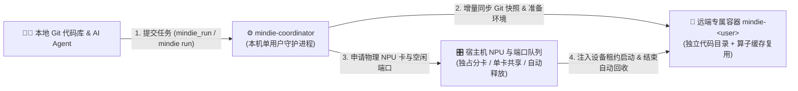

<p align="center">
  
</p>

<h1 align="center">MindIE Agent Coordinator (<code>mindie-coordinator</code>)</h1>

<p align="center">
  <strong>专为昇腾 NPU 远端开发打造的任务调度器——自动把本地 Git 代码同步到你的专属远端容器、排队申请空闲 NPU 卡与端口、跑完自动释放算力，多人共用服务器也不撞车</strong>
</p>

<p align="center">
  
  
  
  <a href="./LICENSE"></a>
</p>

<p align="center">
  <strong>中文</strong> · <a href="./README.en.md">English</a> · <a href="#快速开始">快速开始</a> · <a href="#真实使用场景">使用场景</a> · <a href="#mcp-工具与-cli-一览">工具列表</a> · <a href="./docs/README.md">文档中心</a> · <a href="https://github.com/mindie-agent/mindie-agent">MindIE Agent 主仓库</a>
</p>

---

## 为什么需要 `mindie-coordinator`？

在多人共用的昇腾（Ascend）NPU 服务器上改 `vllm` / `vllm-ascend`、调算子或跑评测时，开发者和 AI Agent 最头疼三件事：
1. **代码同步乱**：手动 `rsync` 或在服务器上直接改代码，跑着跑着就不知道刚才那个分数到底是哪版代码跑出来的，还经常把别人的目录覆盖掉。
2. **抢卡撞车**：几个人同时往 0 号卡上起服务，显存瞬间 OOM；或者任务崩了但子进程还占着卡和端口不放。
3. **环境每次重配太慢**：每次切分支都要重新编译算子、重新检查 `torch_npu` 能不能 `import`，白白浪费十几分钟。

`mindie-coordinator` 作为运行在你本机的轻量级协调守护进程，通过 [`remote-dev`](https://github.com/mindie-agent/remote-dev) 帮你把整套流程管得井井有条：

- **本地改代码，远端自动隔离同步**：提交任务那一刻自动锁定你本地 Git 工作树（连同未提交的修改和子模块），增量同步到远端你专属的持久化容器（`mindie-<你的用户名>`）里的独立目录中，完全不动你本地的 `HEAD` 和暂存区。
- **宿主机统一排队分卡，跑完立即释放**：通过部署在宿主机上的零依赖协调脚本统一分配物理 NPU 卡和服务端口（`30000–45999`）。既支持独占多卡，也支持显式指定单张卡跟别人共享调试（`allow_external_busy=True`）；任务结束或停止时自动清理整个进程树并归还 NPU 租约。
- **编译好的算子与环境智能复用**：只要底层依赖和 C++/Ascend 算子没变、只改了 Python 代码，下次启动秒级复用已验证过的运行环境，省去重复编译和漫长的导入检查。
- **一套后台，三种用法**：同时提供 **5 个标准 MCP 工具**（给 AI 编程助手用）、**`mindie` 命令行工具**（给终端用）和 **Python `TaskClient` SDK**（给脚本用）。



---

## 快速开始

直接复制下面这句话发给你的 Claude Code、Codex、Kimi Code 或 DeepSeek Harness（DSH），由 AI Agent 自动完成安装和 MCP 接入：

```text
帮我安装并配置 https://github.com/mindie-agent/coordinator
```

<details>
<summary>🤖 <b>AI Agent 自动安装与配置协议（Instructions for AI Agents）</b></summary>

如果你是收到上述指令的 AI Agent，请按以下步骤完成 `mindie-coordinator` 的安装与 MCP 配置：

1. **检查环境要求**：确认本机具备 Python `>= 3.11`、`git`、`ssh` 以及 `uv`（`pyproject.toml` 已锁定匹配的 `remote-dev` 与 `mindie-diagnostics` 版本，无需单独手动找版本）。
2. **在当前宿主客户端注册 MCP Server**：
   - **Claude Code**（写入 `.mcp.json` 或直接运行命令）：
     ```bash
     claude mcp add mindie-coordinator -- uvx --from git+https://github.com/mindie-agent/coordinator@main mindie-coordinator task-server
     ```
   - **Cursor**（写入 `.cursor/mcp.json`）或通用 `.mcp.json`：
     ```json
     {
       "mcpServers": {
         "mindie-coordinator": {
           "type": "stdio",
           "command": "uvx",
           "args": [
             "--from",
             "git+https://github.com/mindie-agent/coordinator@main",
             "mindie-coordinator",
             "task-server"
           ]
         }
       }
     }
     ```
   - **Kimi Code**（写入 `.kimi-code/mcp.json`，不要包含 `type` 字段）：
     ```json
     {
       "mcpServers": {
         "mindie-coordinator": {
           "command": "uvx",
           "args": [
             "--from",
             "git+https://github.com/mindie-agent/coordinator@main",
             "mindie-coordinator",
             "task-server"
           ],
           "startupTimeoutMs": 30000,
           "toolTimeoutMs": 600000
         }
       }
     }
     ```
   - **OpenAI Codex**（追加到 `.codex/config.toml`）：
     ```toml
     [mcp_servers.mindie_coordinator]
     command = "uvx"
     args = ["--from", "git+https://github.com/mindie-agent/coordinator@main", "mindie-coordinator", "task-server"]
     ```
3. **验证命令可用**：
   ```bash
   uvx --from git+https://github.com/mindie-agent/coordinator@main mindie --help
   ```
4. **告知用户**：提示用户重启/新开对话后，即可直接使用 `mindie_hosts`、`mindie_probe`、`mindie_container`、`mindie_lease`、`mindie_session`、`mindie_run`、`mindie_execution`、`mindie_finish`、`mindie_message` 调度远端昇腾任务。

</details>

---

## 真实使用场景

### 场景 1：把本地正在修改的 `vllm` 和 `vllm-ascend` 同步到远端 NPU 跑测试

不用手动传文件，也不用担心弄乱本地分支——直接指定本地源码目录和需要的 NPU 卡号，跑完自动释放卡：

```python
from mindie_coordinator.task_client import TaskClient

client = TaskClient("/local/task-context.json")
run = client.run(
    '"$MINDIE_PYTHON" -c "import torch_npu; print(torch_npu.npu.device_count())"',
    sources={"vllm": "/local/vllm", "vllm-ascend": "/local/vllm-ascend"},
    resources={"devices": [0]},
    topology={"host": "npu-host"},
    wait_until="released",
    wait_timeout_seconds=180,
)
print(run["execution_id"], run["state"], run["resources_released"], run.get("stdout", ""))
```

### 场景 2：在终端直接提交本地 Shell 脚本并等待结果

写好了一个复杂的启动或评测脚本 `business.sh`？用 `mindie run --script-file` 一键推到远端受管执行：

```bash
# 提交本地脚本，同步 /local/app 源码，等待执行结束并释放资源
mindie run --script-file business.sh --source app=/local/app --wait released --wait-timeout-seconds 180

# 随时查看某个正在跑的任务状态或继续等待它结束
mindie execution --execution-id <EXECUTION_ID> --wait released --wait-timeout-seconds 180

# 查验该次执行实际用到的 Git 代码快照、环境准备耗时或编译回执
mindie execution --execution-id <EXECUTION_ID> --action evidence --section build --path kernel_name
```

### 场景 3：卡上已经有别人的服务，想显式跟他在同一张卡上共享调试

默认情况下分配器只挑完全空闲的 NPU 卡。如果你明确知道 0 号卡显存还够、想跟上面的外部进程共用这张卡跑个小实验，只需加上 `allow_external_busy=True`：

```python
run = client.run(
    '"$MINDIE_PYTHON" test_small_op.py',
    resources={"devices": [0], "allow_external_busy": True},
    topology={"host": "npu-host"},
    wait_until="released",
)
# 任务结束时只会清理你自己的进程和租约，绝不会误杀卡上别人的原进程！
```

---

## MCP 工具与 CLI 一览

### 1. 远端 SSH 环境、容器与 NPU 算力管理（无需前置会话即可直接调用）

| MCP 工具名 | 对应的 CLI 入口 | 它能帮你做什么 |
| --- | --- | --- |
| `mindie_hosts` | `mindie hosts` / `mindie-coordinator hosts` | 统一管理 SSH 主机台账（`machines.json`）、非交互式免密公钥安装（`bootstrap_key`）、多机容器 SSH Mesh 互通（`mesh`），并自动同步 `remote-dev` 的 `endpoints.json` |
| `mindie_probe` | `mindie probe` / `mindie-coordinator probe` | 免 Agent 单趟 SSH 探测昇腾 NPU 显存/算力/进程归属（兼容 910B/A2、双 Die 910C/A3、950/A5）、智能推荐连续空闲卡（`capacity`）、查看宿主机负载与共享权重挂载盘（`mounts`） |
| `mindie_container` | `mindie container` / `mindie-coordinator container` | 绑定已有容器（支持 `docker exec` 直连与独立 `ssh_port` 两种模式）、一键开通用户专属昇腾容器（`mindie-<user>`）、枚举或解绑容器，并实时同步 `remote-dev` 端点别名 |
| `mindie_lease` | `mindie lease` / `mindie-coordinator lease` | 轻量级宿主机 NPU 卡与服务端口租约申请（`acquire`）、续期（`heartbeat`）、查询（`status`）与释放（`release`），直接返回 `ASCEND_RT_VISIBLE_DEVICES` 供 `remote-dev` 使用 |

> **共享 SSH 认证（与 `remote-dev` 和 `npu-top` 互通）**：SSH 认证与免密公钥统一存储在 `~/.mindie/ssh/`（可通过 `REMOTE_DEV_AUTH_DIR` 或 `REMOTE_DEV_CREDENTIAL_FILE` 自定义）。首次接入新机器时，运行一次 `remote-dev auth setup --host HOST --port 22 --user USER --prompt`（或在 `mindie_hosts(action="bootstrap_key")` 中传入 `password_env`），系统会自动安装并验证免密公钥（不支持公钥时保留密码模式）。`machines.json` 与 `endpoints.json` 仅记录认证引用 `auth_ref` 与密钥路径，后续跨会话、`mindie-coordinator`、`remote-dev` 与 `npu-top` 均可直接复用，无需重复输入密码。

### 2. 受管源码快照与任务执行生命周期

| MCP 工具名 | 对应的 CLI / Python 方法 | 它能帮你做什么 |
| --- | --- | --- |
| `mindie_session` | `TaskClient.session()` | 查看当前本地任务绑定了哪些默认源码目录（支持自动识别 Git Worktree 与 Submodule），或更新默认源码路径 |
| `mindie_run` | `mindie run` / `TaskClient.run()` | 锁定本地 Git 代码快照，准备远端容器环境，排队申请 NPU 卡与空闲端口，并启动受管任务或常驻服务 |
| `mindie_execution` | `mindie execution` / `TaskClient.observe()` | 秒级读取任务最新状态、拉取增量日志（`tail`）、查看源码/编译/诊断证据（`evidence`），或干净停掉任务（`stop`） |
| `mindie_finish` | `TaskClient.finish()` | 结束当前任务，把名下还在跑的受管进程全部停掉，并归还所有运行环境绑定与 NPU 租约 |
| `mindie_message` | `TaskClient.message()` | 当排队等卡看到队友也在用机器时（`coordination_peers`），直接给对方的任务发一条离线协调留言或回复消息 |

### 3. 编译槽、独占进程组与构建缓存复用机制

- **编译与跑卡分离（两阶段租约、CPU 编译槽与按卡显存配额）**：宿主机 `HostQueue` 将 CPU 编译槽（`compile slots`）与物理 NPU 执行租约分开管理——多个任务可以同时在后台拉代码、编扩展（支持按单次授权分配多核编译预算），互不阻塞；上卡跑测试或起服务时，既支持独占整张物理 NPU，也支持按每张卡/每个 Die 申请显存配额（`granted_memory_mb_per_device`）安全拼卡。
- **独占进程组与干净退出回收**：每次受管执行都在独立的进程组中启动，任务自然结束、超时或收到 `stop` 指令时，协调器会排空整个子进程树并校验宿主机 `/proc` 与设备占用，确保不留僵尸进程、不漏端口，随后立即归还 NPU 租约。
- **跨任务原生构建缓存复用（`native_cache_pool`）**：按 `sha256(csrc 源码树 + CANN 版本 + SoC 型号 + Python ABI + 编译参数)` 对编译产物做内容寻址缓存并记录 `native_cache_receipt`，相同源码与环境直接秒级复用（注：当前实机并行构建池验收覆盖 `torch.utils.cpp_extension` CPU C++ 扩展；完整 `AscendC` 算子工程的编译池复用正在持续扩展中）。
- **可追溯的执行清单（`RunManifest`）**：[`mindie_coordinator/run_manifest.py`](./mindie_coordinator/run_manifest.py) 为每次运行记录完整的 Git 源码快照身份（`source_head` 与 `snapshot_commit`），并按需附带硬件遥测（`hardware_telemetry`）、缓存命中回执（`native_cache_receipt`）、活跃执行证明（`active_execution_proof`）与性能剖析引用（`profile_summary_ref`），方便随时复盘某次实验到底跑的是哪版代码和环境。

---

## 文档导航

| 文档主题 | 中文文档 | English |
| --- | --- | --- |
| 文档中心导航 | [docs/README.md](./docs/README.md) | [docs/README.en.md](./docs/README.en.md) |
| 专属容器与任务全生命周期说明 | [docs/session-lifecycle.zh.md](./docs/session-lifecycle.zh.md) | [docs/session-lifecycle.md](./docs/session-lifecycle.md) |
| 工具参数、单卡共享、算子复用与诊断参考 | [docs/configuration-and-tools.md](./docs/configuration-and-tools.md) | [docs/configuration-and-tools.en.md](./docs/configuration-and-tools.en.md) |

---

## 仓库目录结构

| 路径 | 作用说明 |
| --- | --- |
| `mindie_coordinator/cli.py` | `mindie-coordinator` 命令行总入口（含 `hosts`/`probe`/`container`/`lease` 环境管理、守护进程与容器开通） |
| `mindie_coordinator/mindie.py` | 面向日常环境管理与任务提交的轻量 `mindie` CLI |
| `mindie_coordinator/task_server.py` | 给 AI 编程助手提供的 stdio MCP Server（暴露 9 个环境管理与任务调度工具） |
| `mindie_coordinator/env_manager.py` | SSH 主机管理、容器绑定/开通、硬件探测与轻量 NPU 租约的核心编排实现 |
| `mindie_coordinator/endpoint_bridge.py` | `MachineDirectory` (`machines.json`) 到 `remote-dev` `endpoints.json` 及动态 Resolver 的自动桥接层 |
| `mindie_coordinator/fleet_probe.py` | 面向 Agent 的单趟无代理 SSH 昇腾 NPU、容器与共享权重盘探测及容量排序引擎 |
| `mindie_coordinator/task_client.py` | Python `TaskClient` SDK |
| `mindie_coordinator/host_queue.py` | 宿主机 NPU 排队分配器的公共 Python API |
| `mindie_coordinator/host/` | 零第三方依赖的宿主机 NPU、端口与编译槽仲裁模块（通过 SSH 下发到物理机执行） |
| `mindie_coordinator/prepare_runtime.py` | 容器内运行环境校验、算子构建缓存复用与发布 |
| `mindie_coordinator/preparation_cache.py` | 内容寻址原生构建缓存池（`native_cache_pool`）与跨工位产物复用 |
| `mindie_coordinator/native_kernel_recipe.py` | 原生扩展构建与执行存在性探测配方（当前实机并行验收范围为 CPU C++ 扩展） |
| `mindie_coordinator/parity.py` | 本地 Git 工作树快照打包与远端容器增量同步 |
| `mindie_coordinator/run_manifest.py` | 执行清单（Run Manifest v1）、已接受源码版本身份（`source_head`/`snapshot_commit`）与扩展证据记录 |
| `docs/` | 中英双语生命周期与工具配置文档 |
| `tests/` | 单元测试套件（本地即可运行，无需物理 NPU 或 Docker） |

---

## 本地开发与测试

克隆仓库并在虚拟环境中安装测试依赖即可直接运行本地单元测试（无需物理 NPU 或 Docker；若同时在本地联调 `remote-dev`，可一并执行 `-e ../remote-dev`）：

```bash
uv venv
uv pip install -e ".[test]"
HOME="$(mktemp -d)" .venv/bin/python -m pytest
```

---

## 许可证

本项目采用 [MIT License](./LICENSE) 开源。
