# Persistent User Containers & Task Lifecycle Guide

[中文](./session-lifecycle.zh.md) · **English** · [Back to Documentation Index](./README.en.md)

```mermaid
stateDiagram-v2
    [*] --> BindDefaults: 1. mindie_session / Auto-detect local Git repos
    BindDefaults --> SnapshotGit: 2. mindie_run pins working-tree Git snapshot
    SnapshotGit --> PrepareRuntime: 3. Sync into mindie-user & reuse compiled caches (0 NPUs held)
    PrepareRuntime --> LeaseAndRun: 4. Acquire host NPU & port lease and launch workload
    LeaseAndRun --> DrainAndRelease: 5. Process finishes or stops; verify children & ports drained
    DrainAndRelease --> [*]: 6. Return NPU lease; keep container & prepared runtime warm
```

When developing on shared Ascend NPU servers, `mindie-coordinator` follows a simple rule: **every user gets one long-lived personal container per host (`mindie-<user>`, such as `mindie-alice`), but the container itself holds zero NPU reservations. Physical NPUs and service ports are leased from the host only while a workload is actively running, and are returned as soon as the process tree exits — leaving your container and compiled environments warm for the next run.**

---

## Five Core Concepts: What Owns What, and For How Long?

To keep teammates from stepping on each other while avoiding redundant rebuilds, `mindie-coordinator` separates state into five distinct layers:

| Concept | What It Represents | Lifetime |
| --- | --- | --- |
| **Local task** | Your local development session, tracking default source folders, execution IDs, and recorded build/diagnostic evidence | Lives locally on your machine, independent of remote execution |
| **User container (`mindie-<user>`)** | Your persistent Docker container on a remote host (e.g., `mindie-alice`) | **Long-lived across tasks**. Finishing a task never deletes your container |
| **Prepared runtime** | An isolated working directory inside your user container with a selected Python venv, CANN installation, and compiled artifacts | Retained for inspection; compatible dependency and native build artifacts are reused across runs |
| **Runtime binding** | One execution's active checkout of a prepared runtime root | Checked out during preparation and returned after cleanup |
| **Managed execution (`Execution`)** | A single command or service run with pinned Git inputs, a supervised process tree, leased NPU cards, and a service port | From admission until all child processes exit, ports close, and NPU leases are confirmed released |

> [!TIP]
> **Why doesn't a persistent container hog NPUs?**
> Mounting `/dev/davinci*` inside a container does not reserve an NPU. The **host coordinator** on the bare-metal server is the sole authority for NPU leases and service ports (`30000–45999`). Multiple executions can run concurrently inside the same `mindie-<user>` container in separate prepared directories as long as their NPU and port leases do not overlap.

---

## How Environments Are Selected & Isolated

Before launching a workload, `mindie-coordinator` injects the exact **working directory, Python interpreter (`MINDIE_PYTHON`), CANN toolkit path, build artifact paths, and execution-owned log/cache folders** directly into the new process environment — **never modifying global `.bashrc` files or shared symlinks**:

- **Separate roots for `vllm` and `vllm-ascend`**: Each repository gets its own source and build directory.
- **Multiple Python / TorchNPU pairs side by side**: Different virtual environments can hold different compatible `torch` / `torch_npu` versions, selected cleanly via `MINDIE_PYTHON`.
- **Versioned CANN user-space directories**: Toolkit, operator packages, and dynamic library paths are selected together as a coherent bundle.
- **Shared read-only build caches, private run outputs**: Build caches are reused only when inputs match; runtime logs and output files belong exclusively to each execution.

---

## The 7 Stages of a Task Lifecycle

1. **Discover or Set Default Sources (`mindie_session` / Client Hooks)**:
   Native session hooks automatically associate your local task and detect default Git worktrees (including linked worktrees and submodules) from your current directory. You can also set explicit task source defaults at any time via `mindie_session`.
2. **Pin Git Snapshot & Admit (`mindie_run` / `TaskClient.run`))**:
   Captures your local Git commit and working-tree modifications once before admission without altering your local `HEAD` or git index. Commands that don't need source code can omit `sources`, and CPU/build commands default to `npu_count=0`.
3. **Prepare the Container Environment (`Prepare`)**:
   Creates an isolated execution directory inside `mindie-<user>`, syncs the pinned Git snapshot, and reuses compatible dependency/native build artifacts. **No running NPU lease is held during preparation.**
4. **Lease Hardware & Launch (`Execute` / `Serve`)**:
   Acquires the requested NPU cards and service port from the host queue and launches the process with `MINDIE_EXECUTION_OBSERVATION`. Named services (`service="model"`) verify matching inputs and require `restart=True` (with confirmed cleanup of the old instance) before replacement.
5. **Drain Processes & Release NPUs (`Stop` / `Release`)**:
   Terminates only the execution's own managed process family (including child processes), confirms that all descendants have exited and service ports are closed, and then releases the NPU lease while keeping the container and prepared runtime intact. For single-card shared runs (`resources.allow_external_busy=True`), cleanup only checks your own process tree and ports, leaving external workloads on that card untouched.
6. **Close the Task (`mindie_finish` / `TaskClient.finish`)**:
   Tasks that never launched remote executions close immediately in the local registry. Tasks with active executions stop their owned workloads, return all runtime bindings and NPU leases once drained, and mark the task `finished`.
7. **Honest Failure & Reconciliation**:
   If an SSH connection drops during cleanup and the daemon cannot immediately confirm that remote processes or devices are clear, the execution stays in `finishing` until the daemon reconciles it — local process exit or timeout never fabricates a fake release.

---

## Further Reading

- [Tools, Single-NPU Sharing, Build Reuse & Diagnostics Reference](./configuration-and-tools.en.md)
- [Python virtual environments](https://docs.python.org/3/library/venv.html)
- [TorchNPU version compatibility table](https://github.com/Ascend/pytorch/blob/master/COMPATIBILITY.en.md)
- [CANN environment variables reference](https://www.hiascend.com/document/detail/zh/CANNCommunityEdition/82RC1alpha001/maintenref/envvar/envref_07_0003.html)
