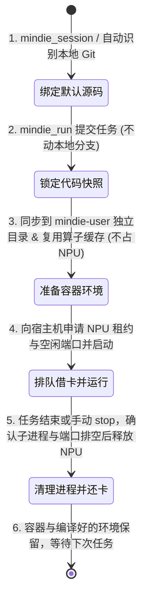

# 专属容器与任务全生命周期说明

**中文** · [English](./session-lifecycle.md) · [返回文档中心](./README.md)

在远端昇腾服务器上开发时，`mindie-coordinator` 的核心设计思路是：**每个人在每台服务器上有一个长期保留的专属容器（`mindie-<你的用户名>`，比如 `mindie-alice`），但容器本身不锁死任何 NPU 卡；只有当你真正跑任务时，才去向宿主机按需借卡，跑完立刻还卡，而你的容器和编译好的环境继续保留，供下次秒开复用。**

---

## 五个核心概念：谁管什么、活多久？

为了既不弄乱别人的环境，又不浪费编译时间，`mindie-coordinator` 把资源拆成了五层：

| 概念名称 | 它具体指什么？ | 它什么时候创建、什么时候销毁？ |
| --- | --- | --- |
| **本地任务（Local task）** | 你在本地打开的一次开发任务，记录默认用哪个本地代码目录、跑过哪些执行、留下了什么证据 | 保存在你本机，跟远端任务跑没跑完互不影响 |
| **个人专属容器（User container）** | 远端宿主机上名叫 `mindie-<用户名>` 的 Docker 容器 | **长期保留**。任务结束了容器也不会删，下次接着用 |
| **准备好的运行环境（Prepared runtime）** | 容器里为某次执行准备的独立工作目录，以及选好的 Python 虚拟环境、CANN 版本和编译产物 | 目录与验证记录保留；只要依赖和算子兼容，后续任务可以直接复用编译产物 |
| **运行时租借（Runtime binding）** | 某次正在跑的任务对上面那个工作目录的“使用权” | 任务开始准备时借出，任务彻底停稳后归还 |
| **单次受管执行（Execution）** | 一次具体的命令或服务运行，包含锁定的 Git 代码版本、派生的进程树、借来的 NPU 卡号和服务端口 | 从提交（Admission）开始，直到确认所有子进程退出、端口关闭、NPU 归还为止 |

> [!TIP]
> **为什么容器一直开着也不会占着茅坑不拉屎？**
> 因为容器挂载了设备节点不代表占用了 NPU。真正的物理 NPU 卡和宿主机端口（`30000–45999`）全部由**宿主机协调器（Host Coordinator）**统一发牌。只要不同任务借的 NPU 卡和端口不冲突，同一个 `mindie-<user>` 容器里完全可以同时跑多个互不干扰的任务！

---

## 环境是怎么隔离和选择的？

每次启动任务时，`mindie-coordinator` 都会把该任务专属的**代码目录、Python 解释器路径（`MINDIE_PYTHON`）、CANN 版本目录、编译产物路径和日志/缓存目录**在进程启动前直接注入环境变量，**绝不去改容器里的全局 `.bashrc` 或公共软链接**：

- **`vllm` 与 `vllm-ascend` 分开存放**：各自有独立的源码目录和构建产物目录，互不污染。
- **多套 Python / TorchNPU 随时切换**：容器里可以并存多套不同版本的 `torch` + `torch_npu` 虚拟环境，通过 `MINDIE_PYTHON` 精确指定。
- **CANN 工具链按目录成套切换**：CANN 的 toolkit、算子包和动态库路径按版本目录整套注入（底层 NPU 驱动与固件则由物理宿主机决定）。
- **编译缓存安全共享，运行输出严格私有**：只有当输入完全匹配时才复用编译缓存；每次运行的日志和输出文件都放在该次执行自己的目录里。

---

## 一次任务从头到尾的 7 个步骤

1. **自动识别本地源码（`mindie_session` / 客户端 Hook）**：
   当你打开会话时，客户端 Hook 会自动根据你当前的本地目录（支持 Git Worktree 和 Submodule）识别出默认的源码仓库。你也可以随时调 `mindie_session` 手动修改默认源码路径。
2. **锁定代码快照并提交（`mindie_run` / `TaskClient.run`）**：
   在任务正式入队前，先把你本地工作树当前的 Git 提交和未提交修改拍个快照固定下来。如果只是跑个普通命令不需要业务代码，可以不传 `sources`；如果是纯 CPU 或编译任务，默认 `npu_count=0`，一张 NPU 卡都不会占。
3. **准备容器内环境（Prepare）**：
   在远端 `mindie-<user>` 容器里创建独立工作目录，把刚才锁定的代码同步过去，并检查能不能直接复用已有的依赖和编译好的原生算子。**注意：准备阶段完全不占用运行态 NPU 租约！**
4. **申请 NPU 与端口并启动（Execute / Serve）**：
   环境准备好后，向宿主机申请所需的 NPU 卡和空闲端口，注入 `MINDIE_EXECUTION_OBSERVATION` 启动进程。如果你启动的是具名常驻服务（比如 `service="model"`），系统会自动核对输入是否一致；想重启替换已有服务时，只需显式传 `restart=True`，系统会先等旧服务彻底清理干净再起新服务。
5. **停止进程并归还 NPU（Stop / Release）**：
   任务跑完或手动调用 `stop` 时，系统只精准终止这次执行派生的进程树（包括子进程），确认进程全退光、服务端口已关闭后，立刻把 NPU 租约还给宿主机队列，同时保留你的容器和准备好的环境。如果你用了单卡共享模式（`allow_external_busy=True`），释放时只会清理你自己的进程和端口，绝不碰卡上别人的程序。
6. **结束整个本地任务（`mindie_finish` / `TaskClient.finish`）**：
   如果当前任务没跑过任何远端执行，直接在本地标记结束；如果还有正在跑的受管执行，`finish` 会把它们全部安全停掉、归还所有绑定和 NPU 卡，最后将任务标为 `finished`。
7. **断网或异常时不瞎报“已释放”（故障对账）**：
   如果释放过程中遇到 SSH 断连、无法确认远端进程到底退没退干净，任务会保持在 `finishing` 状态，由后台守护进程继续联系远端核实清理，**绝不会因为本地进程退出了或超时了就假装“卡已经还了”**。

---

## 延伸阅读

- [工具参数、单卡共享、算子复用与诊断参考](./configuration-and-tools.md)
- [Python 虚拟环境官方文档](https://docs.python.org/3/library/venv.html)
- [Ascend PyTorch (TorchNPU) 版本对应表](https://github.com/Ascend/pytorch/blob/master/COMPATIBILITY.en.md)
- [CANN 环境变量官方说明](https://www.hiascend.com/document/detail/zh/CANNCommunityEdition/82RC1alpha001/maintenref/envvar/envref_07_0003.html)
